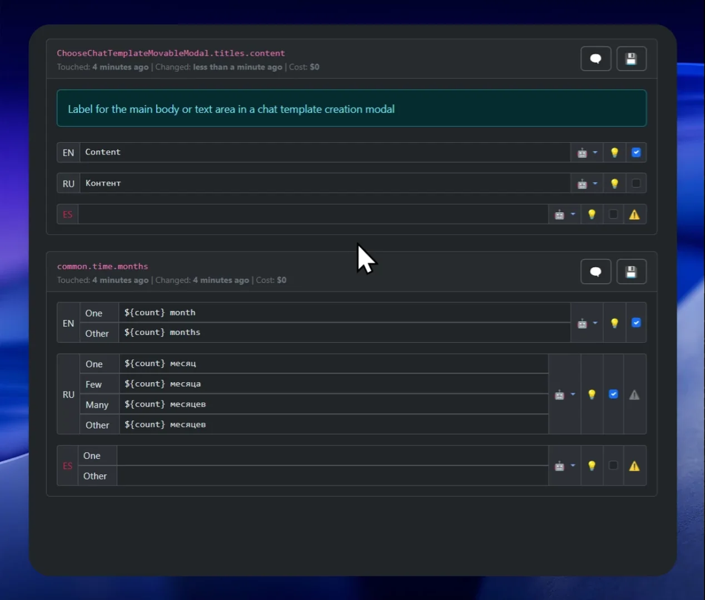
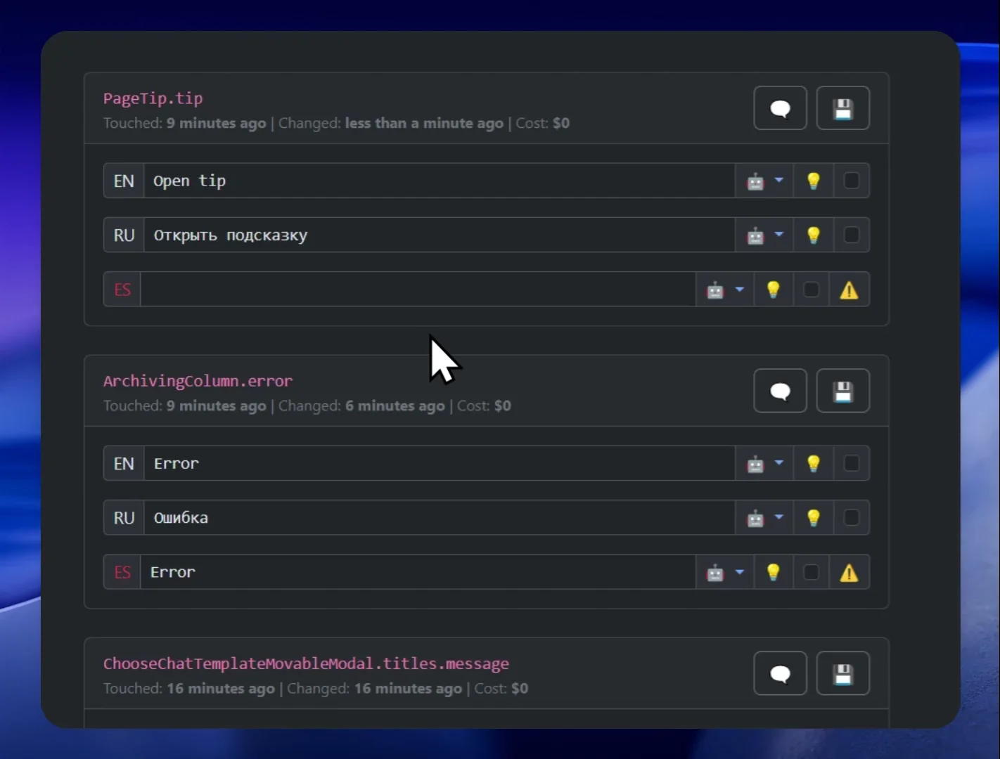
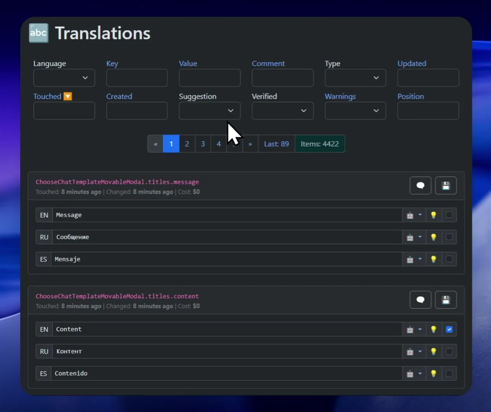

<p align="center">
  
</p>

[Russian](readme.ru.md) | [English](readme.md)
# Lokilizer - opensource инструмент для локализации и перевода приложений на другие языки.

## 🏗️ Установка
Смотрите в [installation.md](installation.md)

## 🚀 Кратко о проекте

Этот инструмент помогает локализовать и переводить приложения на разные языки с помощью любых LLM моделей, совместимых с OpenAI API (`chat/completions`).  
Вам нужно только указать токены, например, для ChatGPT 4.1 или DeepSeek — они уже добавлены в настройках по умолчанию.

> **Disclaimer**: сапожник без сапог 🙈  
> Приложение для перевода — только на английском! Возможно, когда-нибудь я перепишу его на React с красивым фронтом и понятными технологиями под капотом, но пока что есть, то есть. Зато работает!

### Перевод


### Валидация


### Поиск и фильтры


---

## 🎯 Ключевые особенности

### 🌐 Перевод сразу с двух языков

Одна из уникальных особенностей: перевод не с одного языка, а сразу с двух.  
Например, если ваш родной язык — русский, а второй — английский, вы указываете оба варианта перевода.  
Локализатор при добавлении новых языков не просто переводит слова, а анализирует контекст и смысл с обеих сторон, что повышает качество переводов.

### 🧠 Контекст и анализ строк

Перед переводом каждой строки локализатор:
- Анализирует соседние строки и их контекст
- Передает их в LLM с требованием написать комментарий о смысле переводимой строки и как она используется
- Только после этого выполняет перевод  
  **Это серьёзно улучшает качество перевода!**

### 📜 Глоссарий

- Глоссарий создаётся вручную: краткое summary приложения, используемая терминология, и перевод правильный терминов.
- Контролируйте перевод ключевых терминов и их единообразие.
- Добавление нового языка автоматизировано: перевод терминов берётся с учетом всех языков. Легко корректировать вручную.
- Можно создавать "специальные глоссарии" для определённых префиксов ключей переводов (опционально).

---

## 🔤 Про переводы строк

- **Поддержка форматов:** пока только JSON (flat & structured) + плюрализация [i18next](https://www.i18next.com/).
  - Плюрализация: поддерживаются `cardinal` и `ordinal` формы  
    **Пример:**
    ```json
    {
      "key_one": "1 файл",
      "key_other": "{{count}} файлов"
    }
    ```
    Добавить новые форматы файлов можно очень легко.
- **Плейсхолдеры**: `${likeJs}`, `{{doubleCurve}}`, `{singleCurve}` — легко добавить новые форматы.  
  Предпочитаемый формат задается в настройках для каждого проекта
- **Порядок строк** который был в вашем файле сохраняется! Это важно для смысла и для LLM.
- **Многострочные строки**: поддержка `\r` и `\n` (настраивается).
- **Комментарии к строкам**: можно добавить пояснения, которые хранятся только в приложении. По умолчанию генерируются LLM.
- **Рекомендованное значение**: можно не менять перевод, а указать отдельно (например профессиональный переводчик или функция AI Suggest).
- **Массовый или одиночный перевод**, с выбором LLM для каждого языка.
- **Reuse переводов**: при массовом переводе берутся уже переведённые совпадающие строки.
- **Старые строки и переводы не удаляются**, а продолжают хранится в базе. Это частично покрывает функционал ветвления в git,
  когда в одной ветке у вас уже есть новые переводы, а в другой их еще нет. Ничего не потеряется.

---

## 🛡️ Валидация переводов

Все загруженные и переведённые строки проходят проверку и получают флаг `⚠️ Warning` если:
- Строка перевода пустая
- Есть висячие пробелы в начале или конце строки
- Строка содержит несколько пробелов, идущих подряд
- Строка не переведена и совпадает в главным или вторичным языком (вшито исключение для слов `email`, `api`, `ip`, `url`, `uri`, `id`)
- В строке перевода потерян `{{плейсхолдер}}`, который есть в главном языке
- В строке перевода есть устаревший `{{плейсхолдер}}`, которого уже нет в главном языке
- Количество переносов строк (`\r` или `\n`) в главном языке и переводе не совпадает
- Количество символов двоеточия `:` в главном языке и переводе не совпадает
- Нет плюрализованного значения, которое должно быть задано для языка перевода
- Есть плюразованное значение, которого не должно быть для языка перевода
- Плюрализованные значения содержат разное количество переносов строк или символов двоеточия

Вне зависимости от валидации пользователь может принудительно пометить строку как верифицированную, что дает возможность
гибко фильтровать строки и управлять массовым переводом

---

## 🏭 Массовые операции

- `🔤 AI Batch translate` — массовый перевод всех строк на новый язык
- `💡 AI Batch suggest` — рекомендации ИИ (например, исправить ошибки, добавить диакритику), промпт пишете сами, результаты можно принять или отклонить вручную
- `✂️ Batch modify` — массовое удаление комментариев, рекомендаций, висячих пробелов или переводов

---

## 🛠️ Инструменты

- `📢 Alert message` — системное уведомление прямо в интерфейсе. Например, когда работает человек-переводчик, он может попросить других не запускать массове операции.
- `🔠 Text translate` — перевод произвольных текстов через LLM с учетом вашего глоссария (например, новостей для блога).
- `🔢 Plurals` — формы плюрализации и примеры для выбранного языка  
  [Источник Unicode CLDR](https://www.unicode.org/cldr/charts/47/supplemental/language_plural_rules.html)
- `🏘️ Groups analyzer` — анализ больших/маленьких групп строк (родительские ключи в JSON), помогает выявить висячие строки и навести порядок.
- `👯 Duplicate analyzer` — поиск дубликатов строк, контроль единообразия переводов.
- `🕳️ Loosed placeholders analyzer` — поиск строк, где плейсхолдер должен быть, но его нет (например, когда используют конкатенацию вместо плейсхолдера).

---

## 🤖 MCP-сервер для внешних агентов

Lokilizer предоставляет read-only [Model Context Protocol](https://modelcontextprotocol.io/) сервер для каждого проекта. В **настройках проекта** введите Bearer-токен длиной не менее 10 символов или сгенерируйте его кнопкой **Generate**, затем подключите агента к `https://<domain>/mcp/<projectId>`. Оставьте токен пустым, чтобы отключить MCP.

Пример конфигурации клиента:

```json
{
  "mcpServers": {
    "ui-terminology": {
      "type": "http",
      "url": "https://<domain>/mcp/<projectId>",
      "headers": {
        "Authorization": "Bearer <project-token>"
      }
    }
  }
}
```

Доступные инструменты:

- `get_languages` — список кодов языков ISO 639-1 с указанием `primary` и опционального `secondary`; агент должен запрашивать его один раз за сессию.
- `get_glossaries` — возвращает главный глоссарий всего приложения и контекстные специальные глоссарии. Специальная терминология применяется только к функциям или страницам, определяемым по `keyPrefix` и `summary`. Результаты содержат primary, опциональный secondary и рабочий язык, переданный в `language`.
- `search_ui_strings` — поиск актуальных записей по значению сразу на всех языках или только на `searchLanguage`. Инструмент нужен для уточнения терминологии и инструкций с пунктами меню или навигацией. Результаты разбиты на страницы по 50 записей с помощью `page` и содержат ключ, комментарий на primary, значения на primary и опциональном secondary, а также на `searchLanguage` и `resultLanguage`, если они указаны. Релевантность результатов не оценивается, поэтому агенту следует уточнять запрос или просматривать следующие страницы.

---

## 🏢 Проекты, пользователи и роли

- Неограниченное количество проектов, изоляция переводов и всего остального друг от друга.
- Бэкап и восстановление проекта (возможно частичное восстановление, например только глоссарий).
- В проекте любое количество пользователей с разными ролями:
  - **Admin** — полный доступ
  - **Developer** — всё, кроме управления пользователями и LLM
  - **Translator** — работа только с разрешёнными языками, редактирование глоссария, может ставить `📢 Alert message`
  - **Guest** — только просмотр

## 💸 Любая работа должна быть оплачена
Я считаю, что будущее за бесплатными open-source решениями. Я считаю, что это круто, когда ты можешь взять что-то нужное
и полезное, и использовать его бесплатно и без ограничений. И я считаю классным, что заплатить за это можно уже потом, 
если продукт тебе понравился и у тебя есть такая возможность. Буду рад, если вы отблагодарите и меня

- BTC: `bc1qsfn29g67raemehfsu4yhwl6h3tnmkw50n87xxa`
- ETH: `0x10455b5aB8203e01d384682CF3c8E0ff44ffC105`
- LTC: `ltc1qskxa50u4gsn390aj0wu9auu43ggu5m76yp6dc5`
- TON: `UQC29X5L6AR-oWd7OToEMdtSw8-wK78Fv2eqZua8hr64GUse`
- SOL: `74tHqBQWrCXMpYaoycmLumZGzL4H854SsFJEkdUnYg2R`
- XRP: `rUh5YPiab7DN24A4mJMMYYBouNzGBmMXPU`
- BNB: `0x10455b5aB8203e01d384682CF3c8E0ff44ffC105`
- TRX: `TPU3GWSpdpeDTtRbATodGmyoNgUiBzWEvW`
- DOGE: `D6jhNjNaV3ZYAJLrpA7ii6H3TnZEfghiRs`
- ADA: `addr1q8gxxfzqx2t3xms2dxms9lghpytq2lvgam2cr0vl2v0y4dvw7ey94uac45jfzzvsgs90545g8m93lrjkl6c3pw49hnsqqkhyfj`
- USDT (Tron, TRC-20): `TPU3GWSpdpeDTtRbATodGmyoNgUiBzWEvW`
- USDT (Ethereum, ERC-20): `0x10455b5aB8203e01d384682CF3c8E0ff44ffC105`
- USDT (Ton): `UQC29X5L6AR-oWd7OToEMdtSw8-wK78Fv2eqZua8hr64GUse`

Но если вам жалко, то поставьте хотя бы звездочку на гитхабе :D

## 🛡️ Лицензия и условия использования

**Lokilizer** бесплатен для личного и внутреннего коммерческого использования, включая перевод и локализацию собственных коммерческих продуктов.

- **Запрещено** продавать, сдавать в аренду, сублицензировать, предоставлять как платный сервис, размещать в маркетплейсах, использовать как SaaS, облачный или хостинговый сервис для третьих лиц без прямого письменного разрешения автора.
- Все встроенные автором донат-ссылки и рекламные ссылки должны сохраняться и не могут быть удалены, скрыты или изменены при любом развертывании приложения.
- Любое коммерческое распространение, хостинг или предоставление приложения в качестве сервиса третьим лицам строго запрещено.
- Разрешается использовать Lokilizer для локализации собственных коммерческих продуктов, если само приложение не продаётся и не предоставляется как сервис или товар третьим лицам.

Автор оставляет за собой право монетизировать приложение через встроенные рекламные и донат-ссылки.

Для получения специальной коммерческой лицензии свяжитесь с автором.

## 📢 Немного рекламы собственных проектов :)

- [SalesRender](https://salesrender.com) – CRM для интернет продаж. Для интернет-магазинов, колл-центров, CPA-сетей. 
Экспертная поддержка на всех этапах внедрения
- [Ploito](https://ploito.com) - виртуальный офис на удалёнке. Приложение для организации удалённой работы с видео-рацией, 
эффектом телеприсутствия, профилактикой выгорания и трекером здоровья сотрудников
